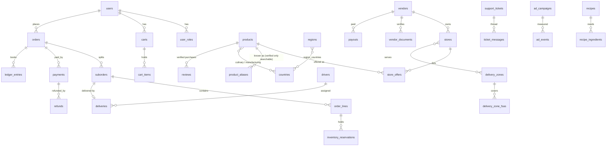

# Architecture and decisions

## Overview
One TypeScript **modular monolith**: a Fastify API with PostgreSQL, and one React (Vite) single-page app with customer, vendor, admin and driver areas (portals are lazy-loaded). No microservices: stock, orders, payments and the ledger must be transactionally consistent, and one deployable is cheaper to run and reason about.

```
browser (customer / vendor / admin / driver areas)
   │  HTTPS, session cookie
   ▼
Fastify API ── routes (validated with zod)
   │            ├─ services: pricing, checkout, orders (state machine), payments (webhooks), refunds, ledger, delivery, notify
   │            └─ jobs: expire stock holds, auto-reject silent stores, send email outbox
   ▼
PostgreSQL (SQL migrations)        Payment provider (Stripe / dev mock)        Email (Resend / log)        Image storage (local disk behind an interface)
```

## Decisions
- **ADR-001 Modular monolith, TypeScript end to end.** Plain SQL migrations and parameterised `pg` queries: stock and money logic is clearer and safer in SQL than behind an ORM.
- **ADR-002 Shared catalogue, per-store offers.** Products hold identity; `store_offers` hold price, stock, active. A scheduled `offer_promotions` row overrides price through the `offers_live` view used by every public read and by checkout.
- **ADR-003 Money is integer cents (CAD).** Rounding helpers use largest-remainder allocation so parts always sum to the whole.
- **ADR-004 Search = Postgres trigram + verified aliases.** Typo tolerance without extra infrastructure at pilot scale. Only *verified* aliases match, so we never imply an unreviewed ingredient equivalence (allergen risk). Every query is logged for unmet-demand analysis. Revisit a search engine when measured need appears.
- **ADR-005 Sessions, not JWTs.** Opaque token in an HttpOnly SameSite=Lax cookie; only its SHA-256 is stored; revocable. Passwords use scrypt. Mutations reject mismatched `Origin`. Auth and sensitive endpoints are rate limited.
- **ADR-006 Authorization is per resource.** Roles live in `user_roles` (vendor roles are scoped to a vendor). Every handler checks the specific resource (own order, own store, own deliveries). Staff have explicit permission sets; only `owner` is a wildcard.
- **ADR-007 Orderable = store published AND vendor approved AND not paused.** Encoded once in the `storefronts` view (also computes open-now in the store's timezone). *Views freeze `s.*`: any migration adding columns to `stores` must recreate the view.*
- **ADR-008 Orders -> suborders -> lines.** One customer order, one suborder per store (separate fulfilment, fees, ETA, commission). Order status and payment status are separate.
- **ADR-009 Reservations, then deduction.** Checkout locks offers (`FOR UPDATE`, stable order), reserves stock; payment confirmation commits it; failure/expiry releases it. `CHECK (stock_reserved <= stock_on_hand)` backs this in the database.
- **ADR-010 Double-entry ledger enforced by the database.** Append-only table plus a deferred constraint trigger that rejects unbalanced transactions at commit.
- **ADR-011 Provider calls happen after commit** (`tx(fn, after)`), never while holding row locks.
- **ADR-012 First-party analytics and error log.** No third-party trackers. Funnel events and server errors are stored in our database and surfaced in the admin console; Sentry can be added by setting `SENTRY_DSN`.
- **ADR-013 Delivery zones are postal-code (FSA) data.** Configurable in the console; no geocoding dependency for the pilot.

## Data model

Database-enforced invariants: non-negative stock; reserved <= on hand; compare-at > price; stock history, audit log and ledger reject UPDATE/DELETE; ledger transactions sum to zero; unique `(provider, event_id)` webhooks; unique idempotency keys for orders, payments and refunds.

## State machine (suborder)
`awaiting_payment -> placed -> accepted -> preparing -> ready -> out_for_delivery -> delivered` (pickup: `ready -> collected`); terminal: `rejected`, `cancelled`, `expired`. A customer may cancel only while `placed`; vendors act on their own orders; drivers only move `out_for_delivery -> delivered`; staff and the system can use any valid transition. History is recorded for every change.

## Regional taxonomy
Regions, countries and mappings are rows; a country may belong to several regions (Cameroon is West and Central). Products carry culinary association and manufacturing origin separately. Collections are rows driven by manual lists or region/category rules. Nothing about regions is hard-coded in the code.

## Security model (see SECURITY.md)
Least privilege, resource-level authorization, server-side validation, magic-byte upload validation, private business documents, audit log of consequential actions, rate limits, strict CORS to one origin, Helmet headers, no secrets in source.
